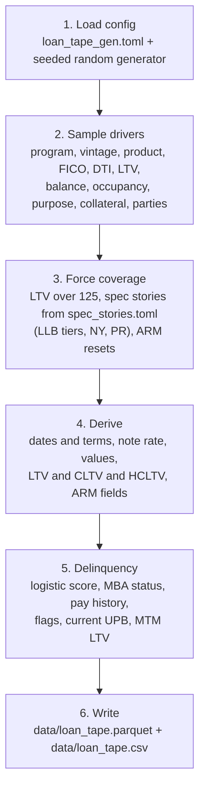

# Loan tape schema

The loan tape is the first thing in the LoanIQ flow: one row per loan. Every later
step reads it: slotting, best execution, positions and the optimizer. This tape is
synthetic. It comes from `backend/app/loan_tape_gen.py`, and every number the
generator uses (distributions, limits, rates, minimum counts) lives in
`backend/app/config/loan_tape_gen.toml`. The spec-pool story rules it must cover
(LLB tiers, NY, PR) live in `backend/app/config/spec_stories.toml`, as SQL tests
over the columns below. All of those numbers are illustrative.

## How the tape is generated



Coverage is forced (step 3) before anything is derived (step 4). That way each
derived field is calculated once, from the final drivers. The delinquency minimums
are met inside step 5, because they change only the performance fields.

Run it from `backend/`:

```powershell
.venv\Scripts\python.exe -m app.loan_tape_gen                      # defaults from config
.venv\Scripts\python.exe -m app.loan_tape_gen --n 5000 --seed 7 --as-of 2026-11-01
```

The same seed, as-of date and config always give the same tape. The as-of date must
be the 1st of a month.

## Types and units

| Type | Meaning |
| --- | --- |
| string | Text. Empty (null) where a field does not apply |
| date | Calendar date, `YYYY-MM-DD` |
| int | Whole number |
| decimal(14,2) | Exact dollars and cents (Parquet DECIMAL; CSV with 2 decimals) |
| float | Decimal number. Rates are in percent with 3 decimals (6.125 = 6.125%); LTVs and DTI are in percent |
| bool | `true` / `false` |

## Fields

### IDs

| Field | Type | Unit | Business meaning |
| --- | --- | --- | --- |
| `loan_id` | string | | Unique loan key: `LN` followed by 8 digits |
| `seller` | string | | Fictional company that originated the loan and is selling it to the desk |
| `servicer` | string | | Fictional company that collects payments. Equals the seller when servicing is retained |
| `channel` | string | | How the loan was sourced: Retail, Correspondent or Broker |

### Program and product

| Field | Type | Unit | Business meaning |
| --- | --- | --- | --- |
| `program` | string | | Conventional, High-Balance, FHA, VA, USDA, Jumbo or Non-QM. Sets the agency or investor the loan can be sold to. Conventional, FHA, VA and USDA loans are at or under the year's FHFA baseline limit; High-Balance is between the baseline and the high-cost ceiling; Jumbo is above the floor in config. No county limits (see `docs/decisions.md`) |
| `product` | string | | 30Y Fixed, 15Y Fixed, 20Y Fixed, 5/6 ARM, 7/6 ARM, 10/6 ARM, or 30Y Fixed IO (Non-QM only). An "n/6" ARM is fixed for n years, then resets every 6 months |

### Dates and terms

| Field | Type | Unit | Business meaning |
| --- | --- | --- | --- |
| `orig_date` | date | | Closing date, from the config's first vintage up to the day before the as-of date |
| `first_pay_date` | date | | First payment due: the 1st of the second month after closing (interest is paid in arrears) |
| `maturity_date` | date | | Last scheduled payment: first payment + (orig_term - 1) months |
| `orig_term` | int | months | Original amortization term: 360, 240 or 180 |
| `loan_age` | int | months | Payments that came due before the as-of date. 0 if the first payment is not yet due |
| `remaining_term` | int | months | orig_term - loan_age (scheduled, ignoring prepayments) |

### Rate and balance

| Field | Type | Unit | Business meaning |
| --- | --- | --- | --- |
| `note_rate` | float | percent | Interest rate on the note: the base 30-year rate for the origination month (`base_rate_30y_by_month` in config; sources in `docs/public-sources.md`), plus product, program and credit add-ons and a little noise, rounded to 1/8. Loans closed in the same month still differ by credit. For ARMs, the start rate |
| `orig_upb` | decimal(14,2) | dollars | Original loan amount |
| `current_upb` | decimal(14,2) | dollars | Unpaid principal balance today: the scheduled balance after the payments actually made (loan_age minus missed payments). A delinquent loan shows its balance as of the last paid installment |
| `pi_payment` | decimal(14,2) | dollars per month | Scheduled principal and interest payment, P = L x r / (1 - (1 + r)^-n) with r = note_rate / 1200. Interest-only loans pay L x r during the IO period |

### Borrower

| Field | Type | Unit | Business meaning |
| --- | --- | --- | --- |
| `fico` | int | score 300-850 | Credit score at origination. The range is set by program (FHA lowest, Jumbo highest) |
| `dti` | float | percent | Monthly debt payments / gross monthly income |
| `first_time_buyer` | bool | | Borrower has not owned a home recently. Only on primary-residence purchases |

### Collateral

| Field | Type | Unit | Business meaning |
| --- | --- | --- | --- |
| `property_type` | string | | SFR (single-family), PUD (planned unit development), Condo, or 2-4 Unit |
| `units` | int | units | 1, or 2-4 for a 2-4 Unit property |
| `occupancy` | string | | Primary, Second Home or Investor. FHA, VA and USDA are primary only |
| `loan_purpose` | string | | Purchase, Rate/Term Refi, or Cash-Out Refi (the borrower takes equity out) |
| `state` | string | | Two-letter postal code, including DC and PR (Puerto Rico) |
| `appraised_value` | decimal(14,2) | dollars | Value at origination, rounded up to $100 |
| `current_value` | decimal(14,2) | dollars | Estimated value today: appraised value x the HPI change since closing x a factor for each home |

### LTV family

| Field | Type | Unit | Business meaning |
| --- | --- | --- | --- |
| `ltv` | float | percent | orig_upb / appraised_value x 100. Above 125 only on FHFA high-LTV refinances |
| `cltv` | float | percent | LTV plus drawn subordinate liens (closed-end seconds and HELOC balances) |
| `hcltv` | float | percent | LTV plus closed-end seconds plus the full HELOC line, drawn or not. HCLTV ≥ CLTV ≥ LTV |
| `mtm_ltv` | float | percent | current_upb / current_value x 100. Above 100 means the borrower owes more than the home is worth |

### Performance

| Field | Type | Unit | Business meaning |
| --- | --- | --- | --- |
| `dq_status` | string | | MBA status: Current, 30, 60, 90, 120+, FC (foreclosure), BK (bankruptcy), REO. Comes from a logistic risk score on FICO, DTI, LTV, investor and cash-out, calibrated to the target rate in config |
| `days_past_due` | int | days | Days from the oldest unpaid due date to the as-of date. 0 when nothing is missed |
| `pay_history_12m` | string | 12 characters | One character per month, oldest first, the last one being the as-of month. `0` paid; `1`-`4` payments missed (4 = 4 or more); `F` foreclosure; `B` bankruptcy; `R` REO; `-` no payment due yet. Delinquency rolls one bucket per month, so the last character always matches dq_status |
| `mod_flag` | bool | | Loan terms were modified, usually after hardship. More common on delinquent loans |
| `forbearance_flag` | bool | | Borrower is in or recently left a payment pause. More common on delinquent loans |

### ARM details (null for fixed-rate loans)

| Field | Type | Unit | Business meaning |
| --- | --- | --- | --- |
| `arm_index` | string | | Rate index the ARM resets to: 30-day Average SOFR. ARMs are 2021+ vintages only |
| `margin` | float | percent | Added to the index at each reset. New rate = index + margin, subject to caps |
| `first_reset_date` | date | | First rate change date: first payment + (fixed months - 1) months |
| `initial_cap` | float | percentage points | Maximum change at the first reset |
| `periodic_cap` | float | percentage points | Maximum change at each later reset |
| `lifetime_cap` | float | percentage points | Maximum rise over the start rate over the life of the loan |

## Simplifications

- **ARMs use their start rate for the whole schedule.** `current_upb` and `pi_payment`
  ignore resets that have already happened.
- **No prepayments or curtailments.** Balances follow the scheduled amortization.
- **No county loan limits.** See `docs/decisions.md`.
- **Modified loans keep their original terms.** `mod_flag` only flags them.
