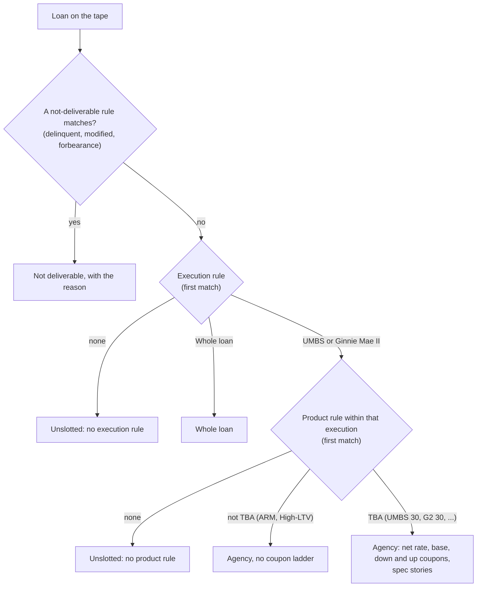

# Product slotting rules
Product slotting decides, for every loan on the tape, where it can be sold and at what
pass-through coupon. It is the step between the loan tape and best execution: Step 6
prices each slot and picks the best one.

Everything here is illustrative. The rules and every number live in one place,
`backend/app/config/slotting.toml`, with the spec stories in
`backend/app/config/spec_stories.toml`. Each rule names its public source, listed in
`docs/public-sources.md`. The plain-English line for each rule, shown on screen, is in
`content/slotting.json`. This page explains how the rules fit together. It does not
repeat their numbers; examples quote today's config.

## The rules, in the order they run
Within each group the first matching rule wins, top to bottom in `slotting.toml`.

1. **Not deliverable.** Agency pools take only loans that are current and performing on
   their original terms. A loan that is delinquent (any MBA status other than Current),
   modified or in forbearance is "Not deliverable", with the first matching reason. It is
   sold as a whole loan, usually at a discount, and Step 6 prices it separately.
2. **Execution.** Conventional and High-Balance loans go to UMBS; FHA, VA and USDA loans
   to Ginnie Mae II; Jumbo and Non-QM loans are sold whole. Each pass-through execution
   carries its fees.
3. **Product.** Within UMBS or Ginnie Mae II, the loan's product: UMBS 30, 20 or 15,
   G2 30 or 15. High-Balance fixed-rate loans get their own slot, because a TBA pool may
   hold only a small share of them. Refinances above 125 LTV and SOFR ARMs go into
   specified, non-TBA pools, so they get no coupon ladder.
4. **Coupons**, for TBA products only (below).
5. **Spec stories**, for TBA products only: every story in `spec_stories.toml` the loan
   carries, for the tape products that story lists. For a tiered story (low loan
   balance) only the tightest tier the loan fits is shown: an $80,000 loan fits every
   LLB tier, and LLB_85K is the one a desk quotes first.

A loan that no execution or product rule covers is "Unslotted", with the reason. That
is a gap in the config, not a business outcome, and a test fails if the default tape
has any.

## The coupon formula
A pass-through coupon is what the pool pays investors. The note rate must cover it plus
the servicer's fee and the guarantee fee. All rates in percent; fees in basis points
(1 bp = 0.01%).

    spread       = note rate - coupon
    min spread   = minimum servicing fee + guarantee fee          (bps, per execution)
    net rate     = note rate - min spread                         (percent)
    base coupon  = the highest coupon step at or below the net rate
    down coupon  = base - one step, kept if its spread <= the maximum spread
    up coupon    = base + one step, kept if its spread >= min spread - maximum buy-down

- The **down coupon** pays investors less. The seller keeps the difference as excess
  servicing, or takes cash for a higher guarantee fee (a buy-up).
- The **up coupon** pays investors more. The seller pays cash to lower the guarantee fee
  (a buy-down), up to the execution's maximum buy-down.
- One step each way is fixed by the slot columns (`base_coupon`, `down_coupon`,
  `up_coupon`); see `docs/decisions.md`, 2026-11-25.
- The arithmetic runs in DuckDB as exact DECIMAL, so a spread exactly on a limit counts
  as inside it.

**Worked example (today's config: UMBS min spread 75 bps, max 250, buy-down up to 25;
coupons in half points).** A conventional 30-year loan at 6.875%:
- net rate = 6.875 - 0.75 = 6.125, so the base coupon is **6.0** (spread 0.875)
- down coupon 5.5: spread 1.375, under the 2.50 maximum, so **5.5** is offered
- up coupon 6.5: spread 0.375, below the 0.50 floor (0.75 - 0.25), so **none**

The same loan as FHA (Ginnie Mae II, spread 25 to 75 bps, no buy-down) has net rate
6.625 and base coupon **6.5** (spread 0.375); the down coupon's spread would be 0.875,
above 0.75, so Ginnie Mae II offers only the base coupon here. More worked examples,
including each limit's edge, are the cases in `backend/tests/test_slotting.py`.

## The slot columns
Slotting runs once, when the tape loads, and adds these columns to every loan
(`SLOT_COLUMNS` in `backend/app/slotting.py`). The grid sorts and filters on them like
any tape field, and Ask the Tape can query them.

| Column | Type | Units | Meaning |
| --- | --- | --- | --- |
| `slot_status` | string | | Agency, Whole loan, Not deliverable or Unslotted |
| `slot_reason` | string | | Why the loan is Not deliverable or Unslotted; empty otherwise |
| `execution` | string | | UMBS, Ginnie Mae II or Whole loan; empty if not deliverable |
| `slot_product` | string | | The agency product (UMBS 30, G2 30, UMBS ARM, ...); empty otherwise |
| `net_rate` | decimal(8,4) | percent | Note rate minus the minimum spread; TBA products only |
| `base_coupon` | decimal(6,3) | percent | Highest coupon at or below the net rate; TBA products only |
| `down_coupon` | decimal(6,3) | percent | One step below the base, if within the maximum spread |
| `up_coupon` | decimal(6,3) | percent | One step above the base, if within the buy-down limit |
| `spec_stories` | string | | The loan's spec stories, e.g. "LLB_110K, NY"; TBA products only |

## Not covered yet
- Seasoning: older loans going into seasoned pools instead of new TBA pools.
- Pool-level limits, such as the High-Balance share of a TBA pool. Slotting is per
  loan; pooling is Step 8.
- Prices. Step 6 prices each slot from the price file.
