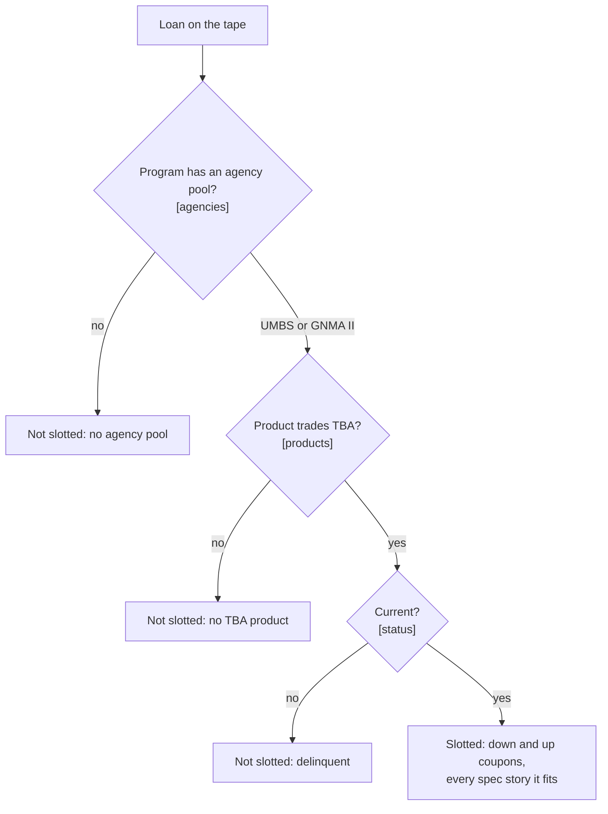

# Product slotting rules
Product slotting decides, for every loan on the tape, which agency pool it can go into,
at which pass-through coupons, and which spec stories it fits. It sits between the loan
tape and best execution: Step 6 prices each slot and picks the best one. There is no
slotting screen; a run updates the Loan Tape, which gains two columns (Slot and Spec
Stories) and a hover card per loan.

Everything here is illustrative. The rules and their numbers live in one place,
`backend/app/config/slotting.toml`, with the spec stories in
`backend/app/config/spec_stories.toml`. Sources are in `docs/public-sources.md`, which
also lists the rules that have no recorded source. Visitor-facing words are in
`content/slotting.json`. This page explains how the rules fit together; it does not
repeat their numbers, and the examples quote today's config.

## The checks, in the order they run
The first check a loan fails is its reason, so every not-slotted loan is counted once.

1. **Agency.** `[agencies]` maps each loan program to UMBS or GNMA II, or to `none`.
   Every program the tape generator can produce must be in exactly one list; a missing
   or doubled program stops the app.
2. **Product.** `[products]` lists the products that trade as TBA coupons, with the
   term label each slot shows (`30Y Fixed` -> `30Y`). ARMs and interest-only loans
   are not listed, so they are not slotted.
3. **Status.** `[status]` names the one MBA status agency pools take (`Current`).

Known simplification: modified loans, loans in forbearance and high-LTV refinances are
slotted if they pass these three checks (docs/decisions.md, 2026-11-25).

## The coupon rule
In percent, from `[coupons]`:

    down coupon = FLOOR((note rate - minimum strip) / coupon step) x coupon step
    up coupon   = down coupon + coupon step

The strip is servicing plus the guarantee fee: what comes out of the note rate before
investors are paid. Rounding down keeps at least the minimum strip.

| Note rate | Minus 0.50 strip | Down | Up |
| --- | --- | --- | --- |
| 3.125 | 2.625 | 2.5 | 3.0 |
| 3.000 | 2.500 | 2.5 | 3.0 |
| 2.875 | 2.375 | 2.0 | 2.5 |
| 6.999 | 6.499 | 6.0 | 6.5 |

The arithmetic is exact: the SQL turns rates into whole units of 0.0001% and rounds
down with integers, because DuckDB divides DECIMALs as binary floating point.

## Spec stories
Only slotted loans carry stories, and only for the products each story lists in
`spec_stories.toml`.
- **A loan can carry several stories.** A $60,000 loan in New York with a 650 FICO fits
  LLB, NY and Low FICO. It still goes into one pool, so pay-ups never stack; Best
  Execution picks the best one.
- **LLB keeps only the lowest tier a loan fits.** A $268,800 loan fits the $275K tier
  only; a $60,000 loan fits every tier and shows LLB 85K, the tightest pool, which a
  desk quotes first.
- A slotted loan with no story is **generic TBA**.

## How a run works
`POST /api/slotting/run` streams one event per step, then the totals:

1. Load the tape, then load the rules (validated when the app started).
2. One pass in DuckDB writes a staging table, one row per loan: `loan_id`,
   `eligible`, `reason`, `agency`, `term`, `down_coupon`, `up_coupon`, `stories`,
   plus the grid's text columns `slot` and `spec_stories`.
3. Count queries over that table give each step's commentary: the three checks, the
   eligible loans by agency, the coupon range, one step per story family, the
   overlaps.
4. The last step publishes in one transaction: the staging table becomes `slots`,
   and the view `loans_slotted` (the tape plus Slot and Spec Stories) becomes what
   the Loan Tape pages.

With four story families that is 13 steps; a new family in `spec_stories.toml` adds one
step by itself. The result is shared by every visitor and lives in memory, like the
tape: after a restart `GET /api/slotting/status` says not run.
